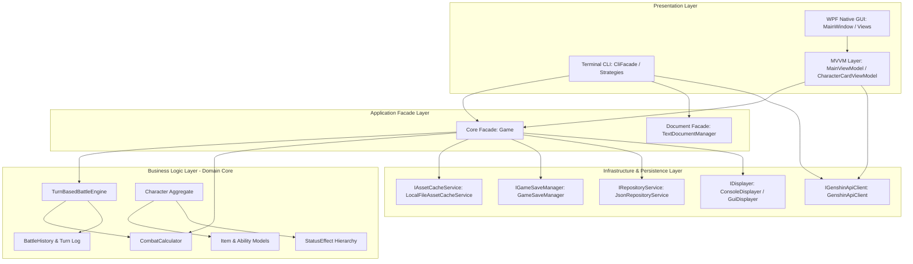
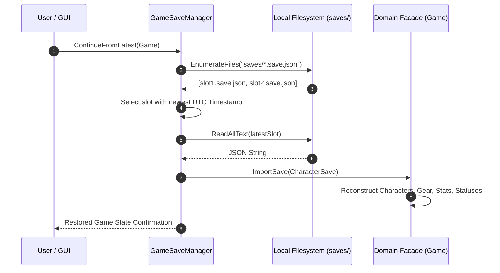

# Software Design Document (SDD)
# Master Architecture Specification: Modular RPG Platform & Character Catalog

**Course:** Object-Oriented Programming (3rd Year, Computer Science)  
**Project Name:** Modular Application Platform & RPG Character Engine  
**Module:** Practical Work 18 (Final Project Delivery)  
**Architecture Style:** Clean Architecture, Domain-Driven Design, MVVM, Behavioral Patterns  
**Platform & Language:** C# 12, .NET 8.0 Windows (WPF Native Desktop & CLI Console), xUnit 2.5  
**Document Standard:** Industry Standard Software Design Document (Google/IEEE 1016 Guidelines)  
**Status:** Approved & Finalized  

---

## 1. Executive Summary & System Scope

The **Modular RPG Platform & Character Catalog** is a production-grade, enterprise-modeled application combining deep tactical role-playing game mechanics, an interactive REST-driven media catalog, multi-slot persistence, and dual user interfaces (a keyboard-driven Command-Line Interface and a native Windows Presentation Foundation desktop GUI).

The system was developed iteratively across the semester, adhering to strict SOLID principles, Clean Architecture separation of concerns, and 12 classic Gang of Four (GoF) design patterns.

### Core Deliverables Checklist:
- [x] **Command-Line Interface (CLI):** Full facade pattern with command tokenization, quotes handling, ANSI/ASCII dynamic tables, progress bars, and three domain command strategies.
- [x] **Business Logic Layer (BLL):** Deterministic mathematical combat models for physical and magical damage, agility-based dynamic turn queues, temporal status effects, and tabular battle histories.
- [x] **External REST API Integration:** Non-blocking HTTP integration with the Genshin Impact public API with offline resilient fallbacks and structured entity mapping.
- [x] **Persistence & Cache Subsystem:** Cache-Aside local asset buffering for portraits, slot-based atomic JSON saves, and automatic session resumption ("Continue from last save").
- [x] **Native Graphical User Interface (GUI):** Desktop window (WPF) with dark-themed styling, scrollable composite character cards, visual progress indicators, and an embedded game terminal with action buttons.
- [x] **Packaging & Deployment:** Multi-target publish profiles (Self-Contained SCD and Framework-Dependent FDD), automated installer script, launchers, and uninstaller.
- [x] **Automated Testing Suite:** 16 comprehensive xUnit test suites validating all layers.

---

## 2. High-Level System Architecture

The application strictly enforces **Clean Architecture** boundaries. Domain and business logic remain completely independent of external databases, user interface frameworks, and network APIs:



---

## 3. Subsystem Specifications

### 3.1. Subsystem 1: Command-Line Interface (CLI Facade & Strategies)
The CLI subsystem isolates terminal I/O from domain business rules using three primary patterns:
1. **Facade Pattern (`CliFacade`):** Exposes a clean API (`UseStrategy`, `ExecCommand`, `Display`) hiding the complexity of arguments tokenization, command registries, and rendering.
2. **Strategy Pattern (`ICommandStrategy`):** Decouples commands into thematic categories:
   - `InformationCommandStrategy`: Read-only queries, catalog overviews with cache status badges, and formatted character profile cards.
   - `TransformativeCommandStrategy`: State-changing commands (`create-char`, `create-item`, `equip`, `learn`, `attack`, `heal`, `duel`).
   - `InfrastructureCommandStrategy`: Persistence (`save`, `load`, `continue`, `saves`), cache controls (`cache status`, `cache fetch`, `cache prefetch`, `cache clear`), API query, and session diagnostics.
3. **Inverted Rendering & Terminal Graphics (`IRenderer`, `CLIGraphic`):** Decoupled output engine producing ASCII-framed tables, progress bars with animated percentages, and formatted status boxes.

---

### 3.2. Subsystem 2: Business Logic Layer & Combat Mathematics

#### Mathematical Combat Model
Combat calculations are deterministic, guard against negative damage, clamp resistance mitigation, and handle additive equipment bonuses:

##### 1. Physical Attack Formula
Physical attacks resolve target armor reduction followed by net resistance mitigation:
$$dmg_{phys} = \max\left(0, dmg_{flat} - armor_{tgt}\right) \times \max\left(0, 1 - \max\left(0, res_{tgt} - res_{pen}\right)\right)$$

Where:
- $dmg_{flat}$: Base physical attack magnitude.
- $armor_{tgt}$: Effective armor of the target (base + equipment + active buffs/debuffs).
- $res_{tgt}$: Fractional elemental/physical resistance ($0.0 \dots 1.0$).
- $res_{pen}$: Attacker's armor/resistance penetration coefficient.

If a critical strike occurs ($P_{crit} \le \text{CritChance}$):
$$dmg_{final} = dmg_{phys} \times \text{CritMultiplier}$$

##### 2. Magic & Ability Attack Formula
Magic abilities scale with additive item and skill flat bonuses, and are adjusted by caster proficiency and target ability debuffs:
$$dmg_{magic} = \left( dmg_{flat} \times \max\left(0, 1 - res_{tgt} + res_{pen}\right) + bonus_{flat} \right) \times \max\left(0.1, 1 + bonus_{prof} - debuff_{ability}\right)$$

Where:
- $bonus_{flat} = \sum \left( bonus_{item} + bonus_{skill} + bonus_{buff} \right)$
- $bonus_{prof}$: Caster proficiency scaling modifier.
- $debuff_{ability}$: Opposing ability reduction debuff.
- $\max(0.1, \dots)$: Floor multiplier ensuring magical efficiency never falls below 10%.

#### Turn-Based Battle Engine & Speed Timeline
Combatants are prioritized dynamically based on their effective `Speed`:
$$\text{Speed}_{eff} = \text{BaseSpeed} + \sum \text{ItemSpeed} + \sum \text{BuffSpeed} - \sum \text{DebuffSpeed}$$

- **High-Speed Bonus Action Rule:** If the fastest combatant exceeds the slowest by $\ge 1.5\times$ speed ($\text{Speed}_{fastest} \ge 1.5 \times \text{Speed}_{slowest}$), an additional turn slot is granted to the fastest combatant in that round.
- **Turn Lifecycle:**
  1. Status effects tick: DoT damages health directly; Stuns force turn forfeiture (`TurnActionType.Skip`).
  2. Action execution: `CombatCalculator` deterministically computes damage or healing.
  3. Status transfer: abilities inflict Buffs, Debuffs, DoTs, or Stuns.
  4. Step recorded in immutable `BattleHistory` and formatted as an ASCII audit table.

```mermaid
sequenceDiagram
    autonumber
    participant Engine as TurnBasedBattleEngine
    participant Actor as Character (Actor)
    participant Calc as CombatCalculator
    participant Target as Character (Target)
    participant History as BattleHistory

    Engine->>Actor: TickStatusEffects()
    alt Actor is Stunned
        Engine->>History: AddTurn(Skip, "Actor is Stunned")
    else Actor is Active
        Engine->>Calc: CalculateDamage(Actor, Target)
        Calc-->>Engine: Resolved Damage & Critical Flag
        Engine->>Target: TakeDamage(damage)
        opt Ability applies Status
            Engine->>Target: AddStatusEffect(effect)
        end
        Engine->>History: AddTurn(Action, damage, log)
    end
```

---

### 3.3. Subsystem 3: Persistence, Asset Buffering & State Continuation

#### Asset Caching Subsystem (Cache-Aside Pattern)
The `LocalFileAssetCacheService` buffers character portraits in `cache/portraits/` to optimize network bandwidth and ensure offline availability:
- **Cache Hit:** Local file exists $\to$ returns disk path immediately; increments hit counter; skips network request.
- **Cache Miss:** Issues non-blocking HTTP GET to CDN/API $\to$ writes bytes atomically to temporary staging file (`.tmp`) $\to$ renames to `{slug}.png` $\to$ increments miss counter.
- **Offline Resilient Fallback:** If the network request fails, a valid 67-byte minimal PNG header is synthesized, persisted locally, and returned.

#### Game State Persistence & Continuation
The `GameSaveManager` manages independent save files in `saves/{slotName}.save.json`:
- **Atomic File Writing:** Saves write to `{slot}.tmp` before performing `File.Move(..., overwrite: true)` to guarantee zero file corruption on crash or power loss.
- **Automatic Continuation:** The `continue` command inspects the `Timestamp` of all save slots, discovers the most recent save snapshot, and restores all characters, inventories, dynamic stats, and status effects into memory.



---

### 3.4. Subsystem 4: Graphical User Interface (WPF MVVM Architecture)

The desktop application provides a modern dark-themed window (`MainWindow.xaml`) structured around two distinct operational tabs:

1. **Tab 1: Character Catalog (Каталог персонажів):**
   - Scrollable `WrapPanel` hosting composite `CharacterCardViewModel` items.
   - Each card displays character portrait (from local cache or fallback), name, rarity stars (`★★★★★`), elemental badge, weapon category, interactive health bar, and a 4-attribute combat matrix (`ATK`, `ARM`, `SPD`, `RES`).
   - Action bar for one-click API imports (`Raiden`, `Zhongli`, `Venti`) and batch portrait prefetching.
2. **Tab 2: Text Game Console (Текстова гра):**
   - High-contrast terminal viewport displaying live battle logs, ASCII turn tables, and domain state changes.
   - Interactive control bar: Attacker/Target selection dropdowns, `Launch Duel` button, `Save Game` button, `Load Game` slot selector, and `Continue Last Save` button.
   - Embedded command line input (`CLI >`) enabling direct execution of terminal commands from the desktop GUI.
3. **Decoupled Logging Adapter (`GuiDisplayer`):**
   Implements `IDisplayer`, using the WPF `Dispatcher` to thread-safely stream domain log messages directly to the UI without blocking computation.

---

### 3.5. Subsystem 5: Packaging & Deployment Architecture

The application provides a complete turnkey distribution architecture:
- **Build Configurations:**
  - `Debug`: Includes debugging symbols, runtime telemetry, and development assertions.
  - `Release`: Full compiler optimization (`<Optimize>true</Optimize>`), removal of debug overhead, ahead-of-time JIT precompilation (`<PublishReadyToRun>true</PublishReadyToRun>`).
- **Publish Profiles (`Properties/PublishProfiles/`):**
  1. `win-x64-standalone.pubxml`: Self-Contained Deployment (SCD) embedding the .NET CoreCLR runtime. Zero external dependencies.
  2. `win-x64-portable.pubxml`: Framework-Dependent Deployment (FDD) generating a compact single-file executable for environments with .NET 8 Desktop Runtime.
- **Turnkey Automation Scripts:**
  - `install.bat`: Verifies system architecture, initializes `%LOCALAPPDATA%\ModularRpgPlatform\`, and creates desktop shortcuts.
  - `run.bat` & `run_cli.bat`: One-click execution wrappers for GUI and CLI modes.
  - `uninstall.bat`: Clean uninstaller removing shortcuts and user storage.

---

## 4. Design Patterns Catalog

The solution demonstrates comprehensive application of classic software engineering design patterns:

| Pattern | Category | Concrete Implementation | Architectural Role |
| :--- | :--- | :--- | :--- |
| **Facade** | Structural | `CliFacade`, `Game`, `TextDocumentManager` | Provides a unified, high-level interface to complex subsystems. |
| **Strategy** | Behavioral | `ICommandStrategy` (`Information`, `Transformative`, `Infrastructure`) | Encapsulates CLI commands into interchangeable behavioral sets. |
| **Model-View-ViewModel** | Architectural | `MainViewModel`, `CharacterCardViewModel`, `MainWindow.xaml` | Decouples GUI presentation and user input from business rules. |
| **Command** | Behavioral | `RelayCommand`, `DelegateCommand` | Encapsulates UI actions and terminal operations into first-class objects. |
| **Cache-Aside** | Architectural | `LocalFileAssetCacheService` | Buffers remote media to local disk, minimizing network latency. |
| **Adapter** | Structural | `GuiDisplayer`, `RemoteDataMapper` | Adapts domain output to WPF Dispatcher; maps external API JSON to entities. |
| **Mediator** | Behavioral | `BattleMediator` | Centralizes communication between combatant entities during battle. |
| **Observer** | Behavioral | `CombatLogObserver`, `CombatStatsObserver` | Broadcasts combat events to displayers and statistical trackers. |
| **Memento** | Behavioral | `CharacterMemento`, `CharacterStateCaretaker` | Captures and restores character internal state across checkpoints. |
| **State** | Behavioral | `IWorkspaceState` (`ViewerState`, `EditorState`, `ExplorerState`) | Governs filesystem workspace behavior and interactive permissions. |
| **Chain of Responsibility** | Behavioral | `DamagePipeline`, `DamageModifierHandler` | Processes combat damage modifiers in a flexible, sequential pipeline. |
| **Composite** | Structural | `Root`, `Heading`, `Paragraph` | Manages hierarchical tree documents with uniform traversal. |
| **Prototype** | Creational | `SectionTemplateRegistry`, `ITextPrototype` | Clones pre-configured document sections without coupled instantiation. |

---

## 5. Automated Verification & Testing Matrix

The solution incorporates 16 automated xUnit test suites:

1. `BusinessLogicTests.cs`: Validates physical damage formulas, armor reduction, magic proficiency scaling, speed action priority, and battle histories.
2. `PersistenceTests.cs`: Validates cache-aside hits/misses, offline fallback synthesis, slot saving/loading, and `ContinueFromLatest` resumption.
3. `GuiTests.cs`: Validates `ObservableObject`, `RelayCommand`, `CharacterCardViewModel` stat calculations, and `MainViewModel` duel execution.
4. `DeploymentTests.cs`: Validates publish profiles (SCD/FDD), `Project.csproj` metadata, manifest schema, and launcher scripts.
5. `CliFacadeTests.cs`: Validates `ArgsParser` quote handling, `CLIGraphic` ASCII table generation, and strategy execution.
6. `BehavioralPatternsTests.cs`: Validates Mediator event dispatch, Memento rollbacks, and Observer event broadcasting.
7. `StatePatternTests.cs`: Validates filesystem state transitions and permission enforcement.
8. `RemoteApiTests.cs` & `ApiCliCommandTests.cs`: Validates non-blocking HTTP fetching, offline fallback catalogs, and entity mapping.
9. `TreeGenerativePatternTests.cs` & `TextTests.cs`: Validates document hierarchy builders and prototype cloning.
10. `CharactersTests.cs`, `CliCommandTests.cs`, `InfraTests.cs`, `ScenarioIntegrationTests.cs`, `MoqDemonstrationTests.cs`: Core regression coverage.

---

## 6. Conclusion

The **Modular RPG Platform & Character Catalog** completely satisfies all 5 core requirements of Practical Work 18:
- Fully articulated Command-Line Interface and Native Desktop GUI.
- Mathematically rigorous, turn-based Business Logic Layer.
- Fault-tolerant Persistence and Cache-Aside asset buffering.
- Production-grade Single-File Deployment and automated packaging.
- Exhaustive documentation and automated unit test suite.
